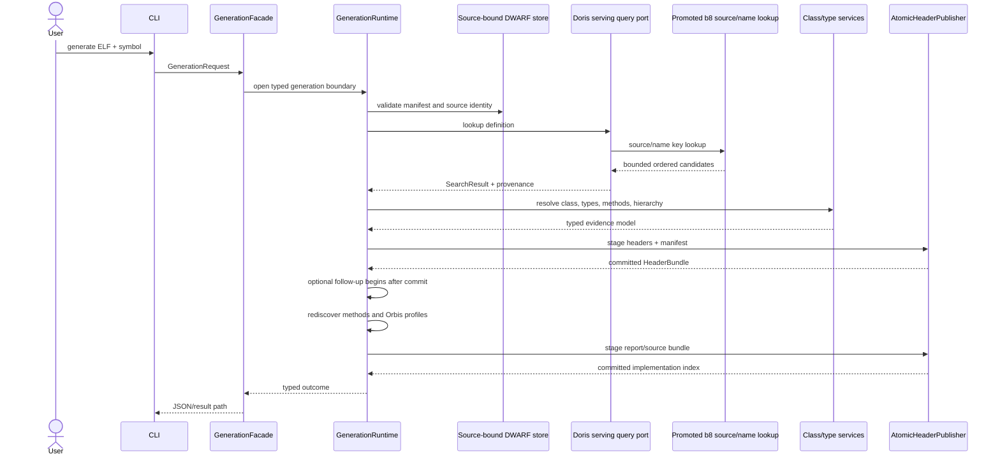
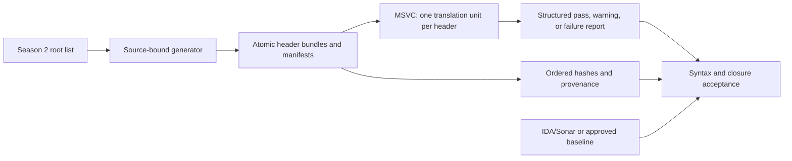
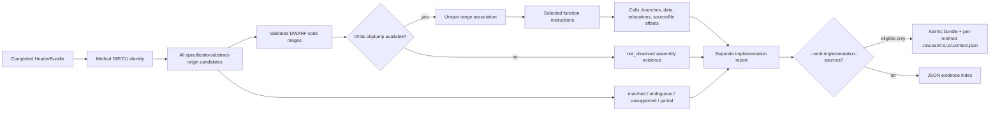
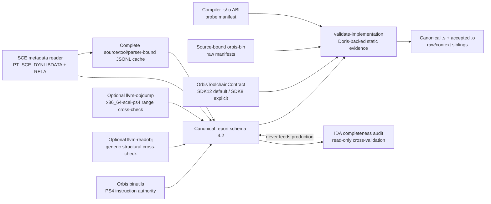

# Runtime flows

## Header generation

The compiler audit is a separate, change-triggered evidence path rather than a normal generation
dependency:

The optional method-body evidence path is also downstream of the completed header bundle:

The implementation evidence boundary is additive and explicit:

The absence of conventional Orbis relocation rows and the documented SDK dynamic-relocation
limitation are separate tool facts. The invalid profile is capability-filtered and is not invoked
on normal runs. These facts do not establish that an ELF has no relocations: SCE
dynamic metadata is parsed independently, with `observed`, `partial`, `malformed`, or
`not_observed` status retained in the report.

The LLVM target profile is never a prerequisite for header publication and cannot change Orbis
method eligibility or generated source selection. Its requested/effective triple, capability
status, range, cache key, and address/byte comparison counts are report metadata; its raw output
and diagnostics remain in the source-bound external cache.

The implementation report is the canonical additive evidence index. It retains exact method-range
text, decoded instructions, instruction-owned references, source/file offsets, all candidates,
tool invocations, and structured limitations. Source emission is a clean assembly handoff, not
behavioral C++ recovery: an inline method without a unique standalone executable range remains
explicit rather than being assigned a caller or thunk by name alone. Each eligible method may
receive bounded `.raw.asm` evidence, canonical `.s`, an accepted `.o`, and a deterministic
`.context.json` transformation packet. `.raw.asm` is never compiler input; `.s` is the only
assembly source passed to `orbis-as`. `artifacts
validate-implementation` is the separate Doris-backed, source-bound static workflow: it requires an explicit
original-address or load-base policy, evaluates relocation formulas without mutating the ELF,
retains opaque NIDs, joins CFI and conservative instruction effects, runs optional Orbis ABI
probes, and emits canonical `.s`/`.o` artifacts. It does not claim PS4 ABI, clobber, stack-safety,
CFG/external-edge parity, or live semantic correctness unless each dimension is independently
observed. The bundle manifest is only an atomic-publication envelope.

Validation is a separate downstream feature rather than a generation dependency. The
`infrastructure/validation` package owns strict validation command wiring and adapts its report to
the neutral context-enrichment provider only when an artifact workflow explicitly requests that
join. Generation, header publication, and default implementation artifact publication remain
usable with the package removed; absent enrichment is represented by the existing
`not_observed` projection.

The implementation report is schema `4.2` and includes the deterministic DWARF-derived target
manifest, scope hash, every retained ELF function candidate, and match reasons. The optional
`audit-implementation-coverage` command consumes that completed report only as a post-generation
IDA completeness check; IDA observations cannot add targets, names, addresses, cache entries, or
status promotion.

The downstream implementation-validation report is schema `4.4`. It joins the selected toolchain
contract, complete external-tool observations, parsed `orbis-bin` stack/dynamic-symbol evidence,
compiler-generated assembly descriptors, and object metadata. The optional sectioned assembly
profile validates `.text.<symbol>` and `EF_FFUNC_DATA_SECS_ENABLED`; byte-replay remains the
default. Static-equivalence dispositions are explicit and legacy 4.3 reports default to
`not_promoted`. `performance analyze-assembly` is intentionally outside this correctness flow because
`llvm-mca` provides performance-model evidence only.

Implementation validation uses a dedicated `DorisImplementationEvidenceModel`. The complete
materialization manifest is read only for source identity, schema, and publication provenance;
the model delegates method DIE hydration, parameter/object locations, and CFI reads to the
source-bound Doris family tables. The normalized typed rows are loaded into Doris once after the
one-time materialization step, and the validator does not read Parquet or JSONL. CFI overlap is
filtered in Doris before the bounded result is returned. If Doris cannot validate the registry
publication, method-specific ABI and CFI evidence remains unavailable.

Symbol generation has one runtime path for one or many roots. The request calls one union
operation, which builds the dependency closure with method-signature dependencies enabled,
assigns ownership to resource directories or `shared/`, and publishes one atomically staged
`generated/ps4-<client-version>/` tree. The version root contains flat headers and, when requested,
flat readable `.asm` evidence; `symbols.manifest.json` and `implementation-report.json` are written
only when context generation is enabled. It does not contain `symbols/`, `implementations/`, or
`methods/<id>/` nesting. `MtDataReader` method-signature resolution is part of this union, and
unresolved definitions remain context diagnostics. The readable `.asm` header uses semicolon
comments, while exact-byte `.s`/`.o` output remains an opt-in separate profile. A single-symbol
invocation uses this same path.

The historical 2026-08-10 Season 2 report passed all 2,760 headers. Warning-only compiler
diagnostics remain evidence; they do not become generated code or runtime dependencies. The
boundary-review baseline is separately normalized to 289 roots, 289 bundles, 289 manifests, 2,745
headers, 3,034 published files, and 2,745 MSVC units. The corrected post-refactor batch-001 run
matched all 598 compared header hashes, and its independent MSVC audit passed 598/598 units (the
focused 11/11 probe also passed). A fresh
full-corpus run is tracked separately and was blocked by two host reboots; its configured
workstation endpoint did not reach the Compose FE at that time.
That historical blocked state was closed by the completed post-refactor run on 2026-08-13; the
fresh run published all 289 roots and matched every baseline header and bundle manifest. The
independent MSVC closure passed 2,745/2,745 units with zero failures and zero timeouts. Incomplete
counts remain separate from this accepted full-corpus evidence.

For the PS4 assembly follow-up, the canonical Compose stack publishes the FE SQL container port
on host port `29030` (with FE HTTP on `28030` and BE Stream Load on `28040`), configured via `.env`.
Historical runs such as the 2026-08-15 `rLayout` revalidation reached Doris on `127.0.0.1:19030` after
an alternate host-port remap; refusals at default `9030` were endpoint mismatches, not Doris availability
failures. The connection boundary records the attempted endpoint explicitly and never substitutes an
unrequested probe.

The historical 2026-08-16 Season 2 rerun covered all 289 resource roots across separate bundles:
2,760 header files were checked without a root generation failure, and 1,150 methods received the
clean `.raw.asm`/`.s`/`.o`/`.context.json` handoff. (The modern Feature 021 architecture generates
all roots into a single flat tree under `generated/ps4-<client-version>/` with ~898 deduplicated
headers). A concurrent-run cache defect was found and fixed by comparing SDK identities after JSON
round-tripping and versioning the disassembly cache key; the affected `rLoadingParam` root was rerun
with observed SCE metadata and no diagnostics. The independent MSVC header closure passed 2,760/2,760
units with zero failures and zero timeouts. The run remains `observed-partial` because ABI/CFI,
register/stack safety, relocation/NID promotion, static parity, and live behavior are separate gates.
The exact counts and external audit links are in the
[Season 2 acceptance record](https://github.com/ddon-research/ddon-dwarf-reconstructor/blob/main/specs/001-header-foundation/acceptance-season2-assembly-20260816.md).

The follow-up validator path now treats Doris as a bounded analytical projection: stable method
requests are fetched in 512-row batches for DIE, parameter, reference, attribute, location, and
CFI context, then served through a read-only context view. Relocation and NID evidence is indexed
once rather than rescanned for every method. This removes the identified algorithmic round-trip
gap. The retained `rLayout` pilot and full Season 2 report both published atomically in the
follow-up run; the full report remains failed because ABI, compiler, instruction-effect, and
semantic-parity gates are incomplete. No arbitrary timeout is used to declare completion.

## Knowledge export

The exporter shares the session, lookup, definition selection, type resolution, and evidence
authority with generation. It then serializes nodes, relationships, instructions, reconstructed
C++, and a manifest. The projection is deterministic and can be loaded by a future graph system.

## Durable reuse

Source identity is checked before a cache or dump index is reused. A warm key may avoid another
full hash when filesystem metadata proves the same object; explicit `verify` always rehashes the
complete source. The normal generation path consumes the source-bound analytical store and never
implicitly performs the expensive CU traversal. A failed atomic materialization leaves the previous
valid store available; the compressed-text SQLite index remains a validation-only cross-check.
Doris request hydration caches are reset at every Season 2 root, while the source/profile-bound
definition-selection cache is retained only after source fingerprint and schema validation. The
latter is a deterministic selection hint, not a compatibility fallback: disabling it changed
header bytes in the `rLayout`/`rTexture` dependency closure. Query sockets use bounded
connect/read/write timeouts, and any timeout or partial query remains non-complete evidence. The
completed benchmark observed warm exhaustive `rAIFSM` p95 of 15.796 seconds and peak RSS of 132.9
MiB; an empty transient Doris query cache is therefore not sufficient to explain the earlier
report of a materially slower `rAIFSM` run.

## Disassembly refactor regression boundary

The disassembly path now shares pure Orbis parsers, one composed profile executor, a typed evidence
projection, canonical content-hash/atomic-I/O helpers, and one source-bound regression manifest
builder. This reduces duplicate ownership without merging header rendering, analytical materialization,
or validation policy. Orbis remains canonical for disassembly, LLVM remains additive, and compiler
probes remain capability evidence.

The 2026-08-18 SDK 12 baseline/post run is external evidence at
`C:\Users\morph\AppData\Local\Temp\ddon-disassembly-refactor-20260818`; its strict comparison
matched all four batches exactly: 289 roots, 2,745 headers, 83,754 method entries, 4,504 artifact
descriptors, and 8,116 files. Report paths/timing are normalized only by an explicit allowlist;
bytes, identities, descriptors, contexts, objects, and normalized evidence facts are not. The
result confirms refactor parity, not ABI, semantic, or runtime equivalence.
